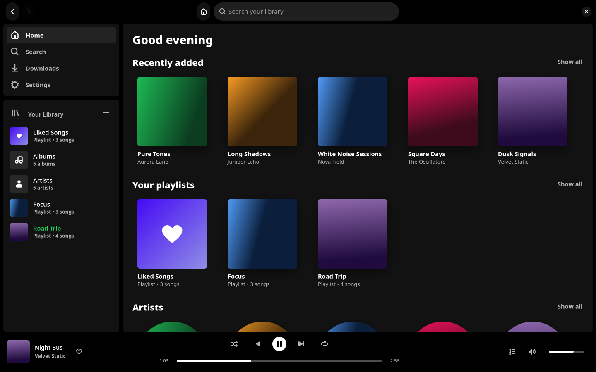
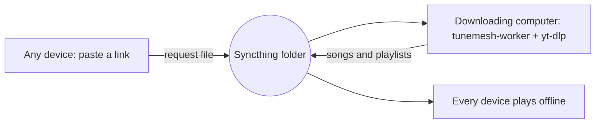

# TuneMesh

A music player for Linux and Android whose whole library is one folder synced
between your devices with [Syncthing](https://syncthing.net). Paste a link to a
song, album or playlist from YouTube, YouTube Music or Spotify; one of your
computers downloads it with [yt-dlp](https://github.com/yt-dlp/yt-dlp), and
Syncthing copies it to every device, where it plays offline.

There is no server, account or cloud: the folder is the library.





- **Linux desktop app** (GTK 4, libadwaita, libmpv): library, albums, artists,
  playlists, Liked Songs, queue, search, media keys (MPRIS).
- **Android app** (Jetpack Compose, Media3): the same library and playlists,
  background playback, a share target to send links from other apps.
- **Downloader** (`tunemesh-worker`): built into the desktop app, or run
  headless as a service. One device per library downloads.

Windows, macOS and iOS are not supported.

## Install

Download the file for your system from the
[latest release](https://github.com/brainage04/TuneMesh/releases/latest)
(replace `<version>` and `<arch>` below with the file's name). Each package
contains the app and the downloader.

| System | Install |
| --- | --- |
| Ubuntu 24.04 and 26.04 LTS, Debian 13+ (amd64, arm64) | `sudo apt install ./tunemesh_<version>-1_<arch>.deb` |
| Fedora (x86_64) | `sudo dnf install ./tunemesh-<version>-1.fc43.x86_64.rpm` |
| Arch Linux (x86_64) | `sudo pacman -U ./tunemesh-<version>-1-x86_64.pkg.tar.zst` |
| Any distribution: Flatpak (x86_64) | `flatpak install --user ./TuneMesh-<version>-x86_64.flatpak` |
| Any distribution: Snap (amd64, arm64) | `sudo snap install --dangerous ./tunemesh_<version>_<arch>.snap` |
| Any distribution: AppImage (x86_64, aarch64) | `chmod +x TuneMesh-<version>-<arch>.AppImage`, then run it |
| Nix / NixOS | `nix profile install github:brainage04/TuneMesh` |
| Android 11+ | Install `TuneMesh-<version>.apk`, or add this repository to [Obtainium](https://obtainium.imranr.dev) for updates |

Notes:

- **Flatpak** needs the Flathub remote for the GNOME runtime
  (`flatpak remote-add --user --if-not-exists flathub https://dl.flathub.org/repo/flathub.flatpakrepo`).
  It can only reach `~/Music/TuneMesh`; for another folder run
  `flatpak override --user --filesystem=<folder> io.github.brainage04.TuneMesh`.
- **Snap**: to let the setup assistant read Syncthing's settings, run
  `sudo snap connect tunemesh:syncthing-config`; for a library on a USB
  drive, `sudo snap connect tunemesh:removable-media`.
- **AppImage** needs glibc 2.39 or newer (Ubuntu 24.04, Debian 13, Fedora 40
  or newer) and adds no menu entry. `./TuneMesh-<version>-<arch>.AppImage worker`
  runs the downloader.
- **Syncthing** is a separate install: `sudo apt install syncthing`,
  `sudo dnf install syncthing`, `sudo pacman -S syncthing`, or see
  [syncthing.net](https://syncthing.net/downloads/). Start it with
  `systemctl --user enable --now syncthing`. On Android use
  [Syncthing-Fork](https://f-droid.org/packages/com.github.catfriend1.syncthingfork/).
- The downloader fetches and updates its own copies of yt-dlp and deno (the
  JavaScript runtime yt-dlp needs for YouTube); ffmpeg comes with the package.
  The Nix packages instead use the yt-dlp, deno and ffmpeg of the nixpkgs
  they were built with and never download their own; update them by updating
  the flake.

<details>
<summary>NixOS and home-manager</summary>

```nix
# flake inputs
inputs.tunemesh.url = "github:brainage04/TuneMesh";

# NixOS: the app, plus the downloader as a user service (optional)
environment.systemPackages = [ inputs.tunemesh.packages.${pkgs.system}.tunemesh ];
systemd.packages = [ inputs.tunemesh.packages.${pkgs.system}.tunemesh ];
systemd.user.services.tunemesh-worker.wantedBy = [ "default.target" ];

# home-manager
home.packages = [ inputs.tunemesh.packages.${pkgs.system}.tunemesh ];
```

A sandboxed system service for an always-on machine is available as
`nixosModules.worker`; see [linux/README.md](linux/README.md#nixos-service).
</details>

<details>
<summary>From source</summary>

Needs Rust, GTK 4.14+, libadwaita 1.5+, libmpv and ffmpeg (or just Nix:
`nix develop`).

```sh
cargo build --release --locked --manifest-path linux/Cargo.toml -p tunemesh -p tunemesh-worker
sudo packaging/linux/install.sh        # installs to /usr/local
```

Android: `cd android && ./gradlew :app:assembleRelease`.
</details>

## Set up

1. **First computer.** Start TuneMesh. The setup assistant asks for the
   library folder (`~/Music/TuneMesh` by default), creates the Syncthing
   folder `tunemesh` for it, shows this computer's Syncthing device ID as a QR
   code, and offers **This device downloads songs**. Turn that on for the
   computer that should do the downloading.
2. **Other computers.** Install TuneMesh, run the assistant, and add each
   other's device IDs. Accept the shared `tunemesh` folder in Syncthing.
3. **Phone.** Install TuneMesh and Syncthing-Fork. The app asks for All files
   access, then walks you through Syncthing: scan the computer's QR code,
   accept the folder `tunemesh` at `/storage/emulated/0/Music/TuneMesh`, and
   keep **Ignore permissions** on.

The assistant can be opened again from Settings or with `tunemesh --setup`.
Every step can be skipped and done in Syncthing's own web interface instead.

### Downloading on an always-on machine

To keep downloading after you close the app, run the downloader as a user
service on one machine (it reads the library folder from
`~/.config/tunemesh/config.toml`):

```sh
systemctl --user enable --now tunemesh-worker
loginctl enable-linger "$USER"   # keep it running while logged out
```

The `.deb`, `.rpm`, Arch, Nix and source installs include this service. With
Nix on a distribution other than NixOS, if `systemctl` says the unit does not
exist, give its path:
`systemctl --user enable --now ~/.nix-profile/share/systemd/user/tunemesh-worker.service`
(the link goes through the profile, so it follows `nix profile upgrade`). With
the Snap, run `snap run tunemesh.worker`, with the AppImage
`./TuneMesh-<version>-<arch>.AppImage worker`, for example from your own
systemd user unit. Only one device downloads at a time; the Downloads page
shows which one.

## Import your music

Open **Downloads** (on any device) and paste links, one per line:

- YouTube and YouTube Music videos, albums and playlists
- Spotify tracks, albums and playlists (public links; no Spotify account needed)
- Other sites yt-dlp supports, or plain search text

Playlist links are saved as TuneMesh playlists with the same name, and big
playlists are fine (up to 5000 songs per link). Each song is found on YouTube
Music and downloaded on the device that downloads; the result syncs
everywhere. Progress, failed songs and warnings show for each link. To import
everything, paste all your playlist links at once.

For Spotify, TuneMesh reads the track list from Spotify's public web pages,
which can change without notice. If it can only read part of a playlist, the
request says so.

## Uninstall

### Linux

If you enabled the downloader service, stop it first:
`systemctl --user disable --now tunemesh-worker`.

| Installed with | Remove |
| --- | --- |
| `.deb` | `sudo apt purge tunemesh` |
| `.rpm` | `sudo dnf remove tunemesh` |
| Arch | `sudo pacman -Rns tunemesh` |
| Flatpak | `flatpak uninstall --user --delete-data io.github.brainage04.TuneMesh` (removes its settings too) |
| Snap | `sudo snap remove --purge tunemesh` (removes its settings too) |
| AppImage | delete the file |
| Nix | `nix profile remove TuneMesh` (the name `nix profile list` shows) |
| From source | `sudo packaging/linux/install.sh --uninstall` |

Then delete your settings, cache and the downloader's tools (not needed after
the Flatpak and Snap commands above):

```sh
rm -rf ~/.config/tunemesh ~/.local/state/tunemesh ~/.cache/tunemesh ~/.local/share/tunemesh
```

### Android

Uninstall the app as usual; that removes its settings, queue and caches.

### Your music and Syncthing

Uninstalling never touches the library folder or Syncthing. To stop syncing,
remove the `tunemesh` folder in Syncthing on that device ("Edit" → "Remove");
the files stay on disk. Delete the folder yourself if you no longer want the
music. Deleting songs **inside** a synced folder deletes them on every device.

## Files TuneMesh creates

| Where | What |
| --- | --- |
| `~/.config/tunemesh/config.toml` | Library path, downloader switch |
| `~/.local/state/tunemesh/` | Queue, position, volume; playlist bases (`playlist-base/`: this device's copy of each playlist from before its own latest edits, for merging Syncthing conflict copies) |
| `~/.cache/tunemesh/` | Library scan cache, covers, downloader scratch space (`worker/`) |
| `~/.local/share/tunemesh/` | The downloader's yt-dlp and deno |
| Library folder | Songs (`<Artist>/<Album>/<Title> [<id>].<ext>`), `Playlists/*.m3u8`, `.tunemesh/` (download requests and status), `.stignore` |

Flatpak keeps the first four under `~/.var/app/io.github.brainage04.TuneMesh/`,
Snap under `~/snap/tunemesh/`.

## Legal

TuneMesh downloads with yt-dlp and reads Spotify's public pages. Downloading
may break the terms of service of the sites involved and copyright law where
you live. Only download what you have the right to. TuneMesh is not affiliated
with Spotify, YouTube or Syncthing.

Third-party licences: TuneMesh is MIT licensed; the software it is built with
keeps its own licences. Every Linux package carries the licences of the Rust
crates linked into both programs (`THIRD-PARTY-RUST.txt` next to TuneMesh's
licence in `/usr/share/licenses/tunemesh/`; in the .deb, both are in
`/usr/share/doc/tunemesh/copyright`). The AppImage, Snap and Flatpak also
bundle libmpv, FFmpeg and other libraries: their licence files ship inside the
package (under `usr/share/doc/<package>/` and `share/licenses/`), and
`THIRD-PARTY-SOURCES.md`, inside each of them and attached to every release,
names the exact source of each bundled component. The bundled libmpv is
GPL-2.0-or-later; the bundled FFmpeg is GPL-2.0-or-later in the AppImage and
Snap (Ubuntu's build) and LGPL-2.1-or-later in the Flatpak. The Android app
lists its libraries' licences in the APK's `assets/NOTICE.txt`, which is also
attached to every release.

## Development

| Directory | What |
| --- | --- |
| `linux/` | Rust workspace: desktop app, downloader and the shared library-format crate ([linux/README.md](linux/README.md)) |
| `android/` | Android app; building, tests and the development checks (ktfmt, detekt, Jazzer, LeakCanary, macrobenchmarks): [android/AGENTS.md](android/AGENTS.md) |
| `docs/library-format.md` | The folder layout and file formats every part shares |
| `packaging/` | Package recipes; `.github/workflows/release.yml` builds and tests them |

Security issues: see [SECURITY.md](SECURITY.md). Licence: [MIT](LICENSE).
